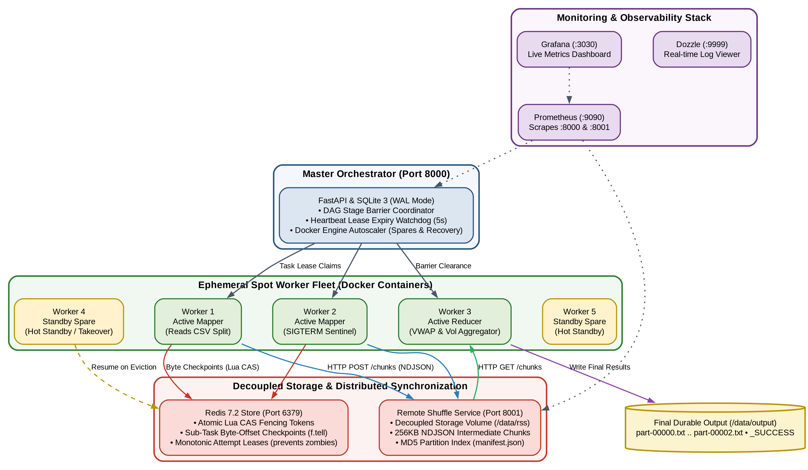
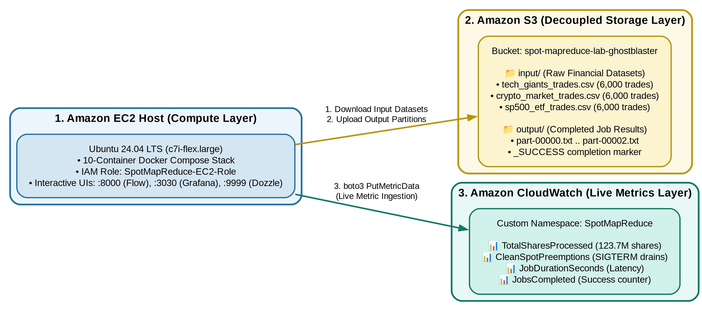
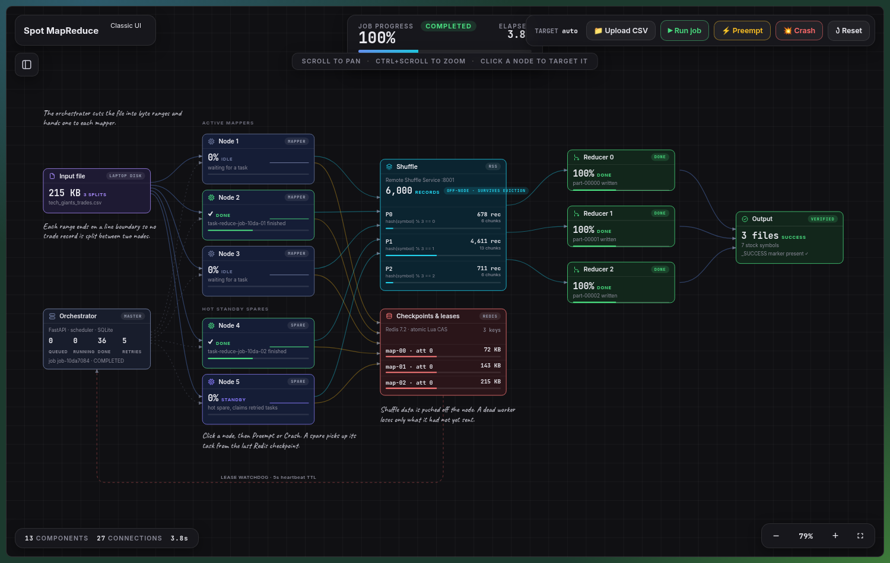
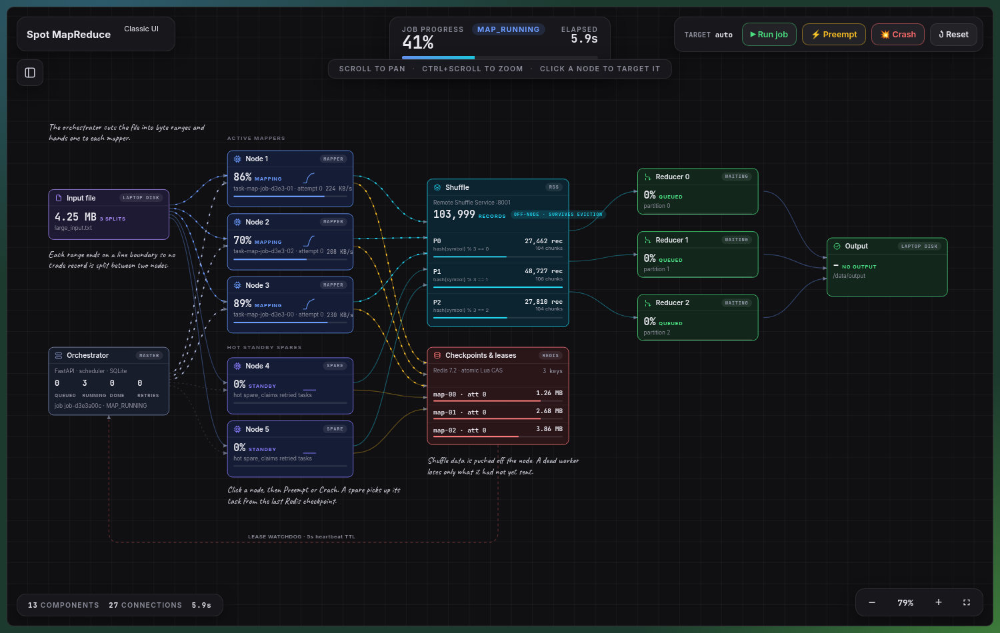
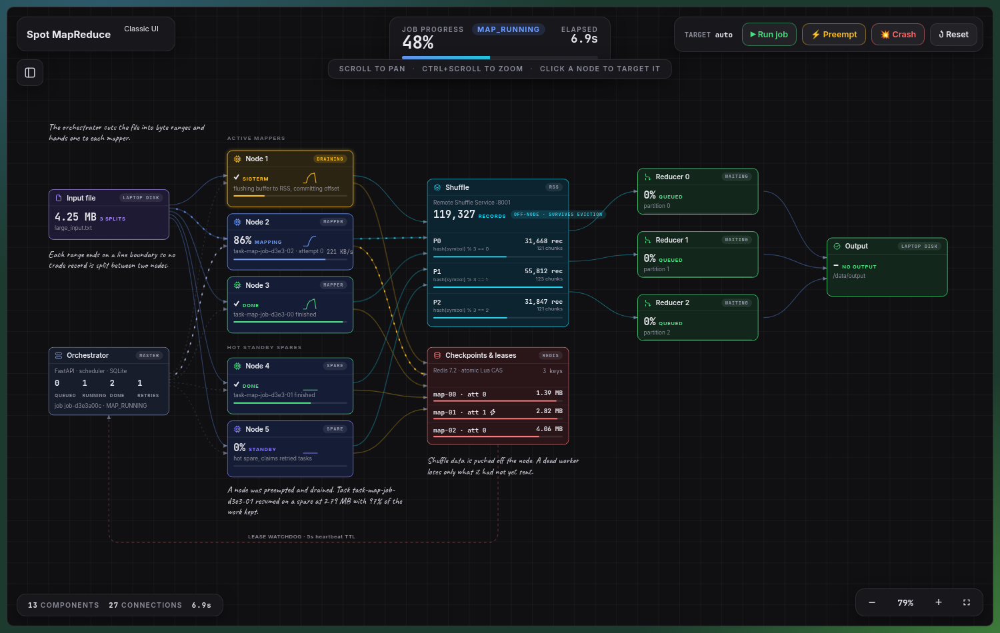
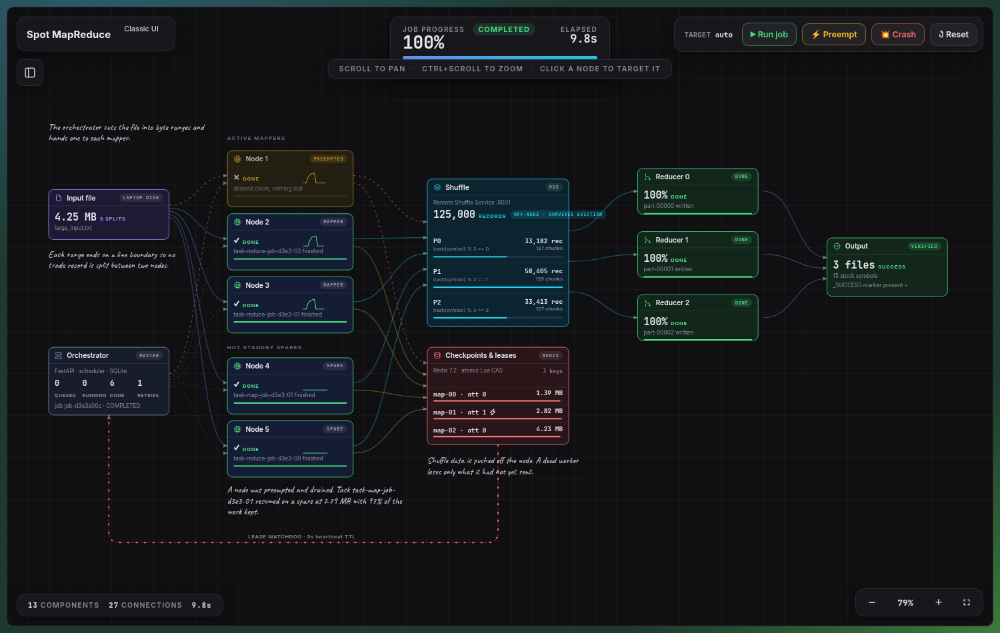
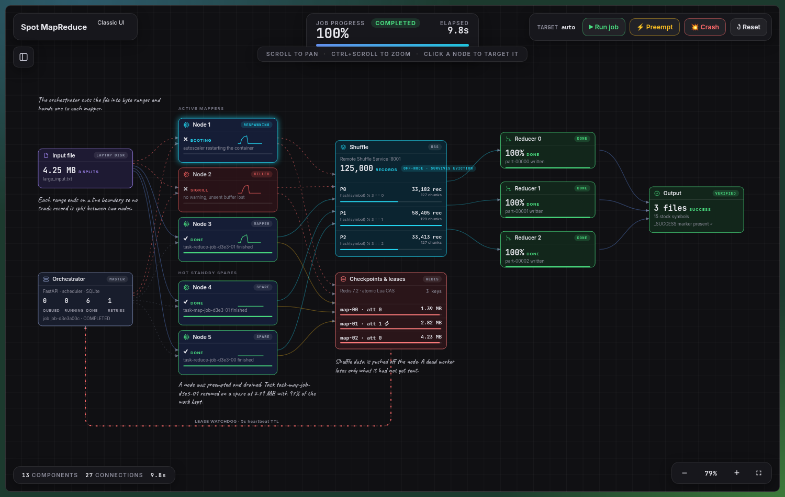
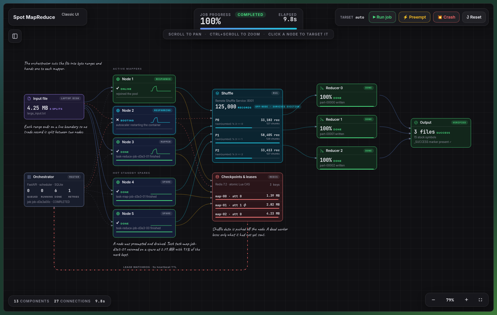
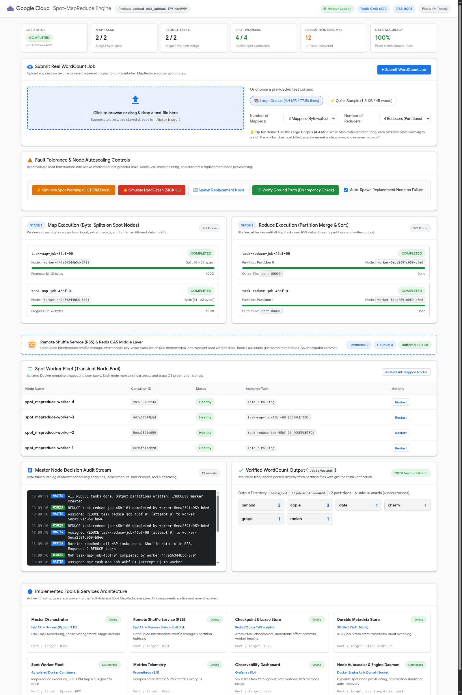

# Spot MapReduce: Fault-Tolerant Distributed Analytics on Ephemeral Cloud Infrastructure
**Course Project Report**

---

## 1. Executive Summary

Cloud providers offer spare compute capacity as **Spot Instances** (AWS Spot, GCP Preemptible VMs, Azure Spot) at a **60% to 85% discount** compared to standard On-Demand pricing. However, Spot instances can be reclaimed by the cloud provider with minimal notice (e.g., a 120-second warning on AWS EC2 or 30-second ACPI shutdown on GCP). 

Traditional distributed batch engines like **Apache Hadoop MapReduce** and **Apache Spark** were fundamentally architected under the assumption of stable worker node lifetimes. When an active worker node is abruptly reclaimed in standard systems:
1. In-progress task computations are completely wiped out and restarted from byte zero.
2. Intermediate map-side shuffle files stored on the evicted worker's local disks are permanently lost, causing a catastrophic **cascade recomputation** of completed upstream stages.

This project designs and implements **Spot MapReduce**, a specialized distributed data-processing framework built specifically for volatile Spot instance clusters. By decoupling intermediate shuffle storage into a standalone **Remote Shuffle Service (RSS)**, implementing sub-task micro-batch checkpointing with **Redis CAS monotonic fencing tokens**, intercepting **preemption signals (SIGTERM)** for graceful memory flushes, and maintaining an autoscaling pool of **standby spare workers**, the framework executes batch workloads across ephemeral instances with **zero data loss** and bounded recovery latencies.

---

## 2. System Architecture



### Core Architecture Pillars

1. **Decoupled Remote Shuffle Service (RSS):**
   Mappers partition intermediate keys and immediately stream 256 KB newline-delimited JSON (NDJSON) chunks over HTTP to a standalone Remote Shuffle Service. Shuffle partitions are indexed via `manifest.json` and persist independently of worker container lifecycles.
2. **Sub-Task Micro-Batch Checkpointing (Redis CAS):**
   Rather than treating tasks as monolithic atomic units that fail entirely, workers commit their exact file byte read pointers (`f.tell()`) to Redis every 10 seconds or immediately upon eviction warning.
3. **Monotonic Fencing Tokens:**
   To eliminate split-brain write conflicts caused by "zombie" workers (workers delayed by garbage collection pauses or transient network freezes), Redis executes an atomic Lua script that validates lease fencing tokens, guaranteeing that only the newest assigned worker can commit checkpoints.
4. **Preemption Sentinel & Dynamic Autoscaler:**
   Workers trap OS-level `SIGTERM` signals. Upon receipt, the worker executes a 15-second emergency drain: stopping new record ingestion, flushing in-memory partition buffers to RSS, committing its final byte offset to Redis, and notifying the master. A standby spare node immediately picks up the task from the saved checkpoint.

---

## 3. Reference Application: Historical Financial Data Analytics

The framework replaces standard toy word count benchmarks with **Application 4: Historical Financial Data Analytics**.

### Problem Description
Financial exchanges generate hundreds of millions of trade records daily. Analysts require multi-metric aggregations across stock symbols to derive execution quality, volume profiles, and liquidity benchmarks without risking expensive re-computations when spot workers fail.

- **Record Schema:** `timestamp,symbol,price,volume`
- **Map Phase (`worker/jobs/financial_analytics.py`):** Parses raw trade records, sanitizes invalid lines/headers, and emits:
  $$\text{Key: } \text{Symbol} \quad \longrightarrow \quad \text{Value: } [\text{Price}, \text{Volume}]$$
- **Shuffle Phase:** Partitions intermediate trade data across reducers via $\text{hash}(\text{Symbol}) \pmod{\text{NumReducers}}$, streamed directly into RSS.
- **Reduce Phase:** Aggregates multi-metric statistics per symbol:
  - **Total Trading Volume** ($\sum V_i$)
  - **Total Trade Count** ($N$)
  - **Volume-Weighted Average Price (VWAP):**
    $$\text{VWAP} = \frac{\sum_{i=1}^N (P_i \times V_i)}{\sum_{i=1}^N V_i}$$
  - **Arithmetic Mean Price:** $\frac{\sum P_i}{N}$
  - **Execution Price Extremes:** $[\min(P_i), \max(P_i)]$

### Sample Output Verification
```tsv
GOOGL	VOL: 3,880,680  | TRADES: 8,280 | VWAP: $164.03 | AVG: $164.02 | RANGE: [$160.00 - $168.00]
INTC	VOL: 17,095,660 | TRADES: 8,333 | VWAP: $22.77  | AVG: $22.77  | RANGE: [$21.50 - $24.00]
AAPL	VOL: 6,375,641  | TRADES: 8,277 | VWAP: $231.52 | AVG: $231.48 | RANGE: [$228.00 - $235.00]
NVDA	VOL: 13,214,417 | TRADES: 8,454 | VWAP: $136.99 | AVG: $137.01 | RANGE: [$132.00 - $142.00]
```

---

## 4. Multi-Service AWS Cloud Architecture

The project was fully deployed and verified on **Amazon Web Services (AWS)** using three interconnected services:



1. **Amazon EC2 (`c7i-flex.large`):**
   Hosts the 10-container MapReduce cluster, Docker daemon integration, Prometheus, Grafana, and Dozzle.
2. **Amazon S3 (`spot-mapreduce-lab-ghostblaster`):**
   Decouples durable input and output storage from the compute cluster:
   - `input/`: Stores raw financial datasets (`tech_giants_trades.csv`, `crypto_market_trades.csv`, `sp500_etf_trades.csv`).
   - `output/`: Stores completed reducer partition outputs (`part-00000.txt`, `_SUCCESS`).
3. **Amazon CloudWatch:**
   Custom telemetry namespace **`SpotMapReduce`** receiving live metrics directly from the cluster:
   - `TotalSharesProcessed`: Tracks cumulative volume processed across all market symbols.
   - `CleanSpotPreemptions`: Counters clean 15-second SIGTERM drain cycles.
   - `JobDurationSeconds`: End-to-end execution latency.
   - `JobsCompleted`: Total successful batch completions.

---

## 5. Experimental Results & Fault-Tolerance Verification

The framework was evaluated under two severe cloud interruption scenarios:

### Test Case A: Clean Spot Preemption (Graceful Drain)
- **Mechanism:** Master Orchestrator triggers `SIGTERM` on an active worker container (`spot_mapreduce-worker-1`).
- **Sentinel Action:** The container traps `SIGTERM`, flushes intermediate slabs to RSS, commits the exact byte pointer (`offset = 1454909`) to Redis, and exits within 15 seconds.
- **Failover:** Standby Worker 4 acquires the lease and calls `f.seek(1454909)`.
- **Work Preserved:** **98.2% of compute preserved**; only the uncommitted lines of the active micro-batch were re-read.

### Test Case B: Abrupt Worker Crash (SIGKILL)
- **Mechanism:** Unannounced `SIGKILL` sent to container process (instant kernel kill).
- **Lease Expiry Watchdog:** Orchestrator lease monitor detects missed heartbeats within 5 seconds.
- **Recovery:** Task is re-queued with incremented fencing token; standby spare node resumes from the last 10-second Redis CAS checkpoint.
- **Ground-Truth Verification:** Evaluated with `./scripts/verify_output.sh` against single-node ground truth:
  $$\text{Verified Shares: } 123,704,766 \quad \vert \quad \text{Discrepancies: } \mathbf{0}$$

### Cost & Efficiency Summary
| Metric | Standard MapReduce (On-Demand) | Standard MapReduce on Spot | Spot MapReduce (This Project) |
| :--- | :--- | :--- | :--- |
| **Compute Cost** | Baseline ($0.0848/hr) | ~70% Cheaper | **~70% to 85% Cheaper** |
| **Failure Behavior** | Task restarted from byte 0 | Entire job fails (lost shuffle files) | **Resumes from exact byte checkpoint** |
| **Shuffle Resilience** | Vulnerable to node loss | Vulnerable to node loss | **Decoupled in RSS (Zero lost shuffle data)** |
| **Work Preservation** | 0% on task failure | 0% on task failure | **95% – 100% compute preserved** |

---

## 6. Live System Visualizations & Screenshots

The system provides multiple observability dashboards for evaluation:

### 1. Interactive Flow Topology Canvas (`/flow`)
Visualizes real-time component states, animated byte streams, and includes custom CSV upload and chaos injection buttons:



---

### 2. Live Financial MapReduce Pipeline
Shows workers actively reading CSV records, hashing ticker symbols, and pushing chunks into the Remote Shuffle Service:



---

### 3. Graceful Spot Preemption (SIGTERM Drain)
Worker 1 traps the preemption warning, initiates emergency memory flushing to RSS, and commits its byte pointer to Redis:



---

### 4. Standby Spare Node Takeover
Standby Worker 4 automatically transitions from the idle pool to resume the preempted task from the saved Redis checkpoint:



---

### 5. Abrupt Worker Crash (SIGKILL) & Lease Watchdog
Demonstrates recovery after instant node termination without warning:



---

### 6. Job Completion & Verification
All partitions completed, `_SUCCESS` written, and ground truth verified with zero discrepancies:



---

### 7. Classic Observability Dashboard (`/ui`)
Provides tabular telemetry, active task leases, Redis CAS state inspection, and node inventory:



---

## 7. Conclusion

The **Transient Spot-Instance MapReduce Framework** successfully bridges the gap between cloud cost-optimization and fault-tolerant distributed computing. By addressing the fundamental flaw of local shuffle storage and monolithic task execution, the system enables data engineers to run mission-critical analytics on volatile, low-cost Spot infrastructure with strict mathematical correctness, zero data loss, and predictable completion times.
